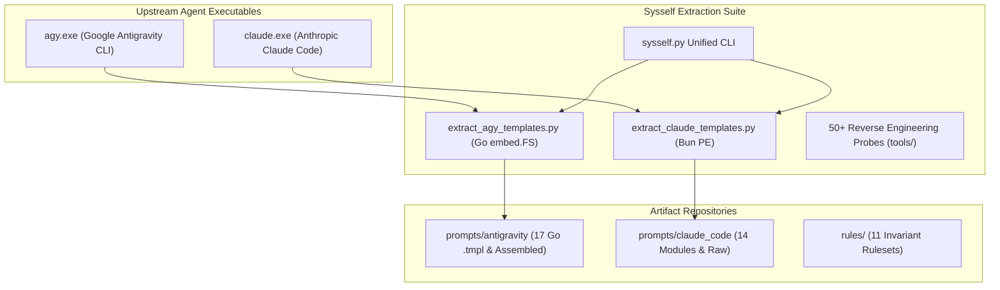

# Sysself

> **Sysself**: Authoritative System Prompts, Binary Extractors, and Engineering Invariants for Agentic AI Coding Environments.

[](LICENSE)
[](https://www.python.org/)
[](sysself.py)



## Quick Start

### 1. View Workspace Status
```bash
python sysself.py status
```

### 2. Extract Official Prompts
```bash
# Extract Google Antigravity templates from agy.exe
python sysself.py extract agy

# Extract Anthropic Claude Code modules from claude.exe
python sysself.py extract claude

# Extract both simultaneously
python sysself.py extract all
```

### 3. Audit Engineering Rulesets
```bash
python sysself.py rules
```

---

## Directory Architecture

```
Sysself/
├── prompts/
│   ├── antigravity/
│   │   ├── assembled/          # Complete assembled runtime prompt
│   │   └── templates/          # 17 Go embed.FS templates (.tmpl)
│   └── claude_code/
│       ├── assembled/          # Composed lin() prompt markdown
│       ├── modules/            # 14 decompiled functional modules
│       └── raw/                # Unescaped JS bundle strings & dumps
├── extractors/
│   ├── extract_agy_templates.py    # Go embed.FS 48-byte table parser
│   ├── extract_claude_templates.py # Bun standalone PE bundle parser
│   └── tools/                      # 50+ reverse-engineering probes
├── rules/
│   ├── developer-environment-and-toolchain-invariants.md
│   ├── android-runtime-and-emulator-invariants.md
│   ├── antigravity-runtime-and-model-invariants.md
│   ├── claude-code-and-promon-automation.md
│   ├── context-and-code-delivery-invariants.md
│   ├── cross-tool-session-handoff.md
│   ├── huggingface-hub-invariants.md
│   ├── mobile-store-listing-invariants.md
│   ├── powershell-execution.md
│   ├── windows-background-automation.md
│   └── github-repository-ruleset.json
├── sysself.py                  # Master CLI controller
├── AGENTS.md                   # Multi-agent coordination rules
├── CLAUDE.md                   # Claude Code workspace guidelines
├── GEMINI.md                   # Google Gemini / Antigravity guidelines
├── .cursorrules                # Cursor IDE ruleset
└── .windsurfrules              # Windsurf / Cascade ruleset
```

---

## License

Licensed under the Apache License, Version 2.0. See [LICENSE](LICENSE) for details.
