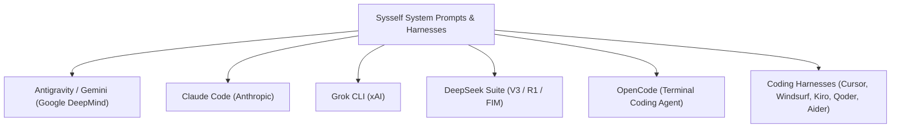

# Official System Prompts & Assembly Manifest

This directory contains pristine, decompiled, and verified system prompts, templates, and agent harnesses across leading AI coding platforms.

## Directory Structure

- **`antigravity/`**:
  - `templates/`: 17 Go `text/template` files extracted directly from `agy.exe` (`embed.FS`).
  - `assembled/`: Canonical runtime prompt used in Antigravity 2.0 / Gemini CLI sessions.
- **`claude_code/`**:
  - `modules/`: 14 modular sections from `claude.exe` (`00_identities` through `12_session_guidance_and_bg`).
  - `raw/`: Unprocessed Bun JS bundle strings and dumps.
  - `assembled/`: Complete, unified Claude Code system prompt.
- **`grok/`**:
  - `modules/`: 11 semantic XML tag modules (`<dangerous_actions>`, `<work_policy>`, `<memory>`, etc.).
  - `bundled_agents/` & `personas/`: Native xAI agents (`explore.md`, `plan.md`, `general-purpose.md`) and TOML personas.
  - `raw/`: Complete session prompts and canonical `tool_definitions.json`.
  - `assembled/`: Unified interactive and subagent worker prompts.
- **`deepseek/`**:
  - `assembled/`: DeepSeek-R1 reasoning prompt (`<think>`), DeepSeek-V3 programming assistant, and FIM auto-completion.
  - `modules/`: Reasoning protocol, coding invariants, and special tokens manifest.
- **`opencode/`**:
  - `assembled/`: Autonomous terminal coding agent system prompt.
  - `templates/`: `opencode.jsonc` configuration template with MCP routing.
- **`harnesses/`**:
  - `cursor/`: Cursor Composer / Agent prompt and `.cursorrules` spec.
  - `windsurf_cascade/`: Cascade Flow agent prompt and `.windsurfrules` spec.
  - `kiro/`: Amazon Q Developer CLI agent prompt and steering specs.
  - `qoder_codebuddy/`: Hook-driven event execution contracts (`PostToolUse`).
  - `aider/`: Architect, Code (SEARCH/REPLACE), and Ask prompt modes.
