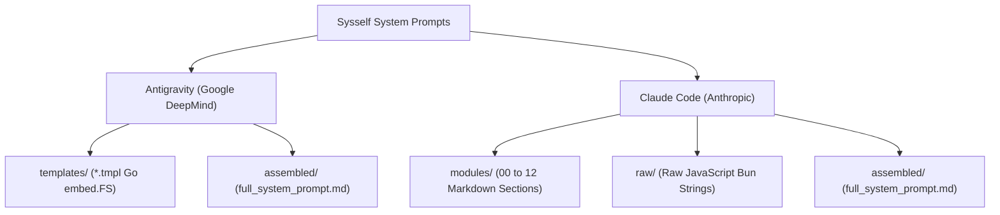

# Official System Prompts & Assembly Manifest

This directory contains pristine, decompiled, and extracted system prompts and templates from next-generation AI coding agents.

## Directory Structure

- **`antigravity/`**:
  - `templates/`: 17 Go `text/template` files extracted directly from `agy.exe` (`embed.FS`).
  - `assembled/`: Fully composed runtime prompt used in active Antigravity 2.0 agent sessions.
- **`claude_code/`**:
  - `modules/`: Modular breakdown of the Claude Code prompt (13 core components).
  - `raw/`: Unprocessed extracted chunks and JS string literals from `claude.exe` (`.bun` bundle).
  - `assembled/`: Complete, unified Claude Code system prompt.
