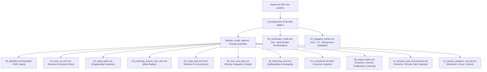

# Claude Code Official CLI System Prompts & Templates

Extracted directly from `claude.exe` (Anthropic Claude Code v2.1.304).

## Architecture Overview

Unlike Antigravity CLI (which relies on static Go `text/template` files embedded in `embed.FS`), Claude Code uses **dynamic functional JavaScript builders** bundled via **Bun Standalone Executable**:

## Extracted Template Files

| File | Module / Generator | Description |
|---|---|---|
| [00_identities.md](file:///E:/02_Projects/Sysself/prompts/claude_code/modules/00_identities.md) | `vt = [le, ke, De]` | Standard CLI, Agent SDK, Pure Agent identities |
| [01_main_cli_intro.md](file:///E:/02_Projects/Sysself/prompts/claude_code/modules/01_main_cli_intro.md) | `Nrr()`, `$rr()`, `B4n` | Intro greeting, CommonMark harness, security guardrails |
| [02_doing_tasks.md](file:///E:/02_Projects/Sysself/prompts/claude_code/modules/02_doing_tasks.md) | `Hrr()` | No unnecessary abstractions, no premature error handling, UI browser checks |
| [03_executing_actions_with_care.md](file:///E:/02_Projects/Sysself/prompts/claude_code/modules/03_executing_actions_with_care.md) | `Brr()` | Blast radius, destructive operations, user confirmations, secrets hygiene |
| [04_using_tools.md](file:///E:/02_Projects/Sysself/prompts/claude_code/modules/04_using_tools.md) | `jrr()` | Dedicated tools vs Bash/PowerShell, parallel tool calls, file edit caching |
| [05_tone_and_style.md](file:///E:/02_Projects/Sysself/prompts/claude_code/modules/05_tone_and_style.md) | `zrr()` | Zero emojis by default, short responses, `file:line` navigation, no colons |
| [06_delivering_work.md](file:///E:/02_Projects/Sysself/prompts/claude_code/modules/06_delivering_work.md) | `Vrr`, `Krr`, `XBs` | Deliverables match requested scope, ambiguity handling, refusal boundaries |
| [07_corrections.md](file:///E:/02_Projects/Sysself/prompts/claude_code/modules/07_corrections.md) | `Yrr`, `JBs` | Minimizing self-correction, dealing with peer agents, moving on cleanly |
| [08_output_styles.md](file:///E:/02_Projects/Sysself/prompts/claude_code/modules/08_output_styles.md) | `j9` profiles | Proactive, Concise, Explanatory, and Learning style instructions |
| [09_coordinator_mode.md](file:///E:/02_Projects/Sysself/prompts/claude_code/modules/09_coordinator_mode.md) | `Opi()` | Multi-worker coordinator: Research, Synthesis, Implementation, Verification |
| [10_subagent_worker.md](file:///E:/02_Projects/Sysself/prompts/claude_code/modules/10_subagent_worker.md) | `Uvs`, `T7t`, `u1s` | Worker subagent rules: cwd reset, absolute paths, direct markdown returns |
| [11_surfaces_and_environments.md](file:///E:/02_Projects/Sysself/prompts/claude_code/modules/11_surfaces_and_environments.md) | `_Mo`, `i1s`, `a1s` | Terminal, VS Code, Desktop, Web, Mobile, Slack, Local vs Sandbox |
| [12_session_guidance_and_bg.md](file:///E:/02_Projects/Sysself/prompts/claude_code/modules/12_session_guidance_and_bg.md) | `nsr()`, `osr`, `asr()` | Worktrees, background jobs, focus mode, XML tag protocols |

## Verification & Parity with Proxymateur

Proxymateur interacts with Claude Code traffic in two critical areas:
1. **Prompt Sanitization** (`src-tauri/src/proxy/mappers/prompt_sanitizer.rs`): Strips Claude Code identity strings (`You are Claude Code...`) and proprietary headers (`x-anthropic-billing-header`).
2. **Tool Protocol Alignment** (`docs/fix_claude_code_tool_use.md`): Claude Code expects parallel tool calling, specific XML result envelopes (`<task-notification>`), and strict JSON parameter typing without tag markup.
