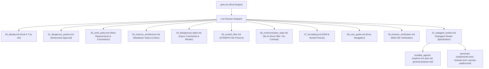

# Grok 4.7 CLI System Prompts & Agent Specifications

Extracted directly from the local xAI Grok Build CLI environment (`C:\Users\X\.grok`).

## Architecture Overview

Grok CLI (xAI Grok Build v1.0.67+) utilizes structured XML boundary sections in its system prompt:

## Inventory

| Folder | Contents |
|---|---|
| [`modules/`](file:///E:/02_Projects/Sysself/prompts/grok/modules) | 11 semantic markdown modules decompiled from XML tags |
| [`assembled/`](file:///E:/02_Projects/Sysself/prompts/grok/assembled) | Canonical full system prompts for main session and subagents |
| [`bundled_agents/`](file:///E:/02_Projects/Sysself/prompts/grok/bundled_agents) | Pre-configured agent personas: `general-purpose.md`, `explore.md`, `plan.md` |
| [`personas/`](file:///E:/02_Projects/Sysself/prompts/grok/personas) | TOML persona definitions (`implementer`, `reviewer`, `security-auditor`) |
| [`raw/`](file:///E:/02_Projects/Sysself/prompts/grok/raw) | Raw unedited session system prompt text & `tool_definitions.json` |
